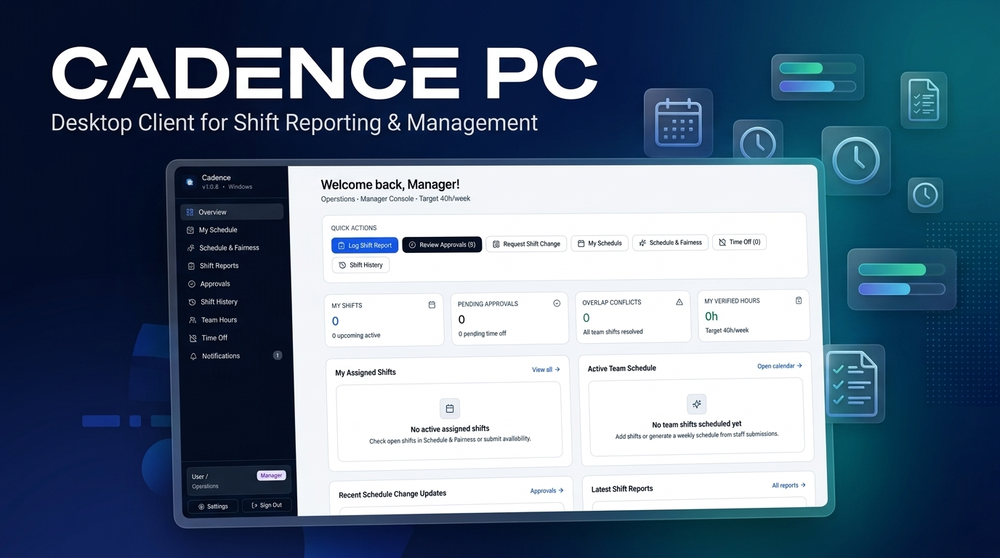

# Cadence — Windows Desktop Shift Reporting & Fair Scheduling (Rust + Tauri)

Cadence is a **Windows desktop application** built with **Rust** (**Tauri v2**, native Windows notifications, system tray, native `.ics` export dialogs, Rust Fairness Engine & GitHub update checker), **React + TypeScript + Tailwind CSS**, and **Firebase (Firestore + Firebase Auth)** for verified shift reporting, manager schedule change approvals, one-click Accept All, and fairness-balanced overlap scheduling.

